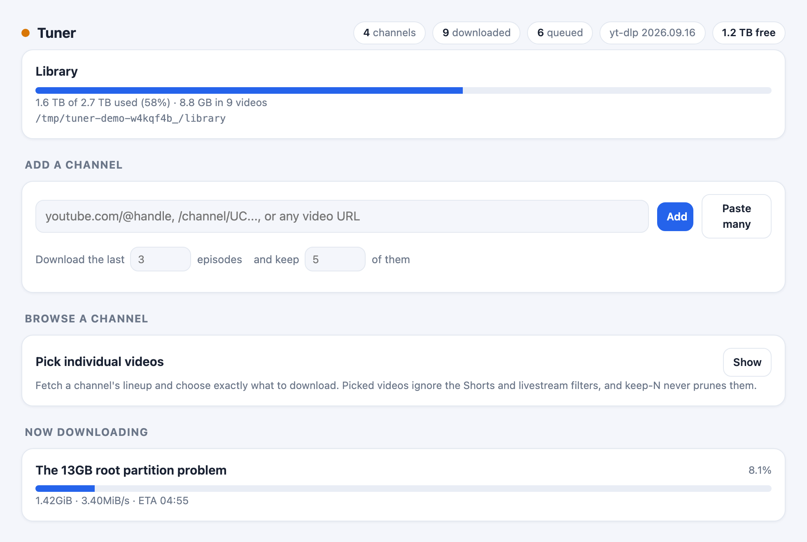
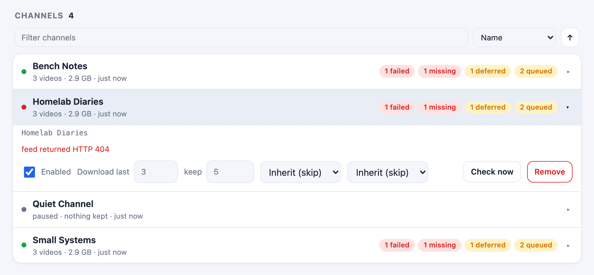
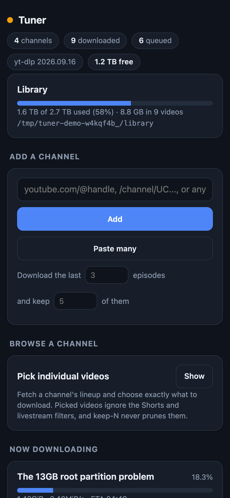

# Tuner

**A recorder for the YouTube channels you follow, filed straight into Jellyfin.**

Tuner is a small self-hosted app for a home server. Paste a channel URL into
its web page; from then on it watches that channel, downloads each new video
with [yt-dlp](https://github.com/yt-dlp/yt-dlp) at 1080p, and files it in a
plain per-channel folder that [Jellyfin](https://jellyfin.org) serves. It
keeps the newest few per channel and deletes what you have watched, so the
drive never fills up.

Python standard library only: no pip packages, no database server, no
JavaScript framework. The only outside programs are `yt-dlp` and `ffmpeg`.

https://github.com/user-attachments/assets/8b091448-20ce-4ada-827b-3b823f966161

*Tuner in 30 seconds. The narration is AI-generated; the screens are the built-in demo.*

<picture>
  <source media="(prefers-color-scheme: dark)" srcset="docs/screenshots/hero-dark.png">
  
</picture>

| The channel list | On a phone |
|---|---|
|  |  |

*Screenshots are of the built-in demo, with made-up channels.*

## Why I built it

Watching [NetworkChuck](https://www.youtube.com/@NetworkChuck),
[Jeff Geerling](https://www.youtube.com/@JeffGeerling) and
[Dammit Jeff](https://www.youtube.com/@DammitJeff) got me into self-hosting:
running the services I use on my own hardware, at home. YouTube was the
obvious place to start. I was tired of the ads, tired of paying, and tired
of Google's incessant tracking.

I also wanted something that works offline, for when I'm on the road
overlanding. The channels I follow should come with me.

So Tuner records them onto my own server and files them in Jellyfin, where
they play with no ad breaks. They are plain MP4 files in plain folders, so
they copy onto whatever travels with me and play with no connection at all.
YouTube sees each download; what I watch, when and how often stays with me.
It cleans up after itself, too, because the drive is never as big as the
backlog. Success, for me, is forgetting Tuner exists and finding the videos
already there.

## What it does

- **Follows channels.** Polls each channel every 30 minutes with jitter,
  using conditional GET on its RSS feed so a quiet channel costs YouTube
  almost nothing. When YouTube refuses the feed (it sometimes blocks a whole
  host), it lists the channel through yt-dlp instead.
- **Takes what you would watch.** Probes each new video first and skips
  Shorts, livestreams and premieres that have not started.
- **Files it for Jellyfin.** One video at a time, 1080p ceiling, H.264
  preferred, remuxed to MP4 so clients play it directly and the server never
  transcodes. English `.srt` subtitles and a `.jpg` poster sit beside each
  file, and the title, channel, date and thumbnail are embedded in it.
- **Keeps the drive in check.** Keeps the newest N per channel, deletes
  videos a grace period after Jellyfin says you watched them, and pauses
  downloads below a free-space floor.
- **Picks by hand too.** Browse a channel's lineup (newest 50 to 500) and
  tick exactly the videos you want.
- **Says why.** One page shows the queue, live progress, disk usage and a
  history with the reason for every skip and failure.

## Quick start (Docker)

```bash
docker run -d --name tuner --restart unless-stopped -p 8770:8770 \
  -v /opt/tuner:/config -v /srv/media/YouTube:/media/youtube \
  ghcr.io/virtualawyer/tuner:latest
```

Each release is published for `linux/amd64` and `linux/arm64`, with ffmpeg
and the current standalone yt-dlp inside. Or use
[`docker-compose.yml`](docker-compose.yml), or build it yourself with
`docker build -t tuner .`.

| Volume | What | Where to put it |
|---|---|---|
| `/config` | `config.json` and the SQLite database (small) | a normal Linux filesystem, **never exFAT or FAT**: SQLite needs file locking |
| `/media/youtube` | the video library | the folder Jellyfin reads; any drive, exFAT is fine |

Open `http://<server>:8770`, paste a channel URL, and press **Add**. Then
[point Jellyfin at the library](#set-up-jellyfin).

[DOCKER.md](DOCKER.md) is the step-by-step version, including Debian's
Docker without the compose plugin and how much root space the image needs.

## Install without Docker

On Debian or Ubuntu, as a systemd service:

```bash
sudo apt update && sudo apt install -y python3 ffmpeg git
sudo curl -L https://github.com/yt-dlp/yt-dlp/releases/latest/download/yt-dlp -o /usr/local/bin/yt-dlp
sudo chmod a+rx /usr/local/bin/yt-dlp
sudo git clone https://github.com/virtualawyer/tuner /opt/tuner-src
```

Install yt-dlp as the **standalone binary**, not the apt package: the
packaged build is usually months old, refuses to update itself, and YouTube
breaks old versions regularly. `ffmpeg` is required: it merges the separate
video and audio streams YouTube serves at 1080p.

Set `library_root` in `/opt/tuner-src/config.json` to your library folder.
If that folder is not under `/srv/media`, change `RequiresMountsFor=` in
`tuner.service` to match, so Tuner waits for the drive at boot instead of
writing into an empty mount point. Then:

```bash
cd /opt/tuner-src && sudo bash install.sh
```

The installer checks python3 (3.9 or newer), yt-dlp, ffmpeg, the library
folder and free space **before** copying anything, so a failed install
leaves nothing half-written. It installs to `/opt/tuner`, keeps the
database in `/var/lib/tuner`, enables `tuner.service`, and prints the URL.
If your firewall is on: `sudo ufw allow 8770/tcp`.

## Set up Jellyfin

1. **Add the library folder** in Jellyfin as type **Movies** (or **Other
   Videos** if your version offers it). If Jellyfin runs in a container, use
   the path *it* sees: with `/srv/media` mapped to `/media`, that is
   `/media/YouTube`. Check with `docker exec jellyfin ls /media`.
2. **Turn every metadata downloader off** for that library. Otherwise
   Jellyfin matches YouTube videos against real films and gives them the
   wrong titles and artwork. Tuner writes no `.nfo` files, so the file names
   are the metadata.
3. Turn on **real time monitoring** so new files appear without a scan.

**To delete videos once watched** (optional): in Jellyfin, **Dashboard → API
Keys → New API Key**. In Tuner's Settings, paste the server URL and the key,
press **Test connection**, pick your user, and switch on **Delete videos once
watched in Jellyfin**. From inside a container, use the host's LAN address
for Jellyfin, since `127.0.0.1` is the container itself.

Tuner deletes the files itself and asks Jellyfin to rescan. It never calls
Jellyfin's delete endpoint, so the key needs no delete rights.

## Using it

Paste any of these into the add field:

```
https://www.youtube.com/@veritasium
https://www.youtube.com/channel/UCHnyfMqiRRG1u-2MsSQLbXA
https://www.youtube.com/c/Computerphile
https://youtu.be/dQw4w9WgXcQ          (adds that video's channel)
@veritasium
UCHnyfMqiRRG1u-2MsSQLbXA
```

**Paste many** takes one URL per line and reports a result for each.

When a channel is added, Tuner downloads its newest few videos (3 by
default) and treats the rest as already seen, then tracks the channel
forward. YouTube's feed only ever lists a channel's latest 15 videos, so
there is no back catalogue to fetch that way; use **Browse a channel** for
older ones.

Each channel row opens in place for its own settings: download the last N,
keep N of them, and whether to skip Shorts and livestreams. A blank value
follows the global setting.

### Picking videos by hand

Subscribing answers "keep me current with this channel". **Browse a channel**
answers "I want those four, and nothing else." Paste a channel URL, choose
how far back to list, tick what you want, and press **Download**. Anything
already downloaded is greyed out.

A picked video differs from a subscribed one in two ways, on purpose: the
Shorts and livestream filters do not apply (you chose it), and keep-N never
prunes it (it stays until you delete it). A channel you have only picked from
is created unsubscribed and never polled.

### Preview it anywhere

```bash
python3 -m tuner --demo
```

Serves sample data from a temp directory. No network request, no
subprocess, nothing written outside that directory, and every button that
would change something answers that this is a demo.

## Configuration

`config.json` lives at `/opt/tuner/config.json` (`/config/config.json` in
Docker). Most of it is editable from the Settings panel; edit the file for
the rest and restart.

| Key | Default | What it does |
| --- | --- | --- |
| `title` | `Tuner` | Header and page title |
| `host` / `port` | `0.0.0.0` / `8770` | Listen address |
| `library_root` | `/srv/media/youtube` | Where videos are filed |
| `db_path` | `/var/lib/tuner/tuner.db` | SQLite database. Must NOT be inside the library |
| `ytdlp_path` / `ffmpeg_path` | `yt-dlp` / `ffmpeg` | Paths to the binaries |
| `poll_minutes` | `30` | Poll interval. Never below 5 |
| `poll_jitter_minutes` | `5` | Random extra delay per cycle |
| `feed_delay_seconds` | `3` | Gap between one channel's request and the next |
| `discovery` | `auto` | `auto` tries RSS then yt-dlp; `rss` or `ytdlp` pins one |
| `seed_n` | `3` | Videos to download when a channel is added. Per channel too |
| `keep_n` | `5` | Keep the newest N per channel. `0` keeps everything |
| `min_free_gb` | `10` | Downloads pause below this much free space |
| `shorts_max_seconds` | `60` | Length that counts as a Short |
| `skip_shorts` / `skip_live` | `true` | Global filters, overridable per channel |
| `subtitles` | `true` | Write English `.srt` sidecars |
| `prefer_h264` | `true` | Ask for H.264 before AV1, so older clients play directly |
| `thumbnails` | `true` | Write a `.jpg` poster beside each video |
| `max_attempts` | `3` | Tries before a download is marked failed |
| `jellyfin_url` | `""` | For example `http://192.168.1.10:8096` |
| `jellyfin_api_key` | `""` | Never sent to the browser in full |
| `jellyfin_user_id` | `""` | Whose watched status counts |
| `watched_delete` | `false` | Delete watched videos |
| `watched_grace_hours` | `24` | Wait this long after watching |
| `jellyfin_poll_minutes` | `15` | How often to ask Jellyfin |

Raising `seed_n` on a channel that is already tracked pulls back videos it
skipped as pre-existing, up to the 15 the feed lists. Videos a filter
skipped stay skipped.

### A password

Set the `TUNER_PASSWORD` environment variable and every page asks for it
(any user name works). It is read from the environment only, so it never
lands in `config.json` or the page. `/healthz` stays open for container
healthchecks.

In Docker, pass it with `-e TUNER_PASSWORD=...`. For the systemd service,
keep it out of the unit file, which any user can read: put
`TUNER_PASSWORD=...` in `/etc/tuner.env`, run
`sudo chmod 600 /etc/tuner.env`, then `sudo systemctl edit tuner` and add:

```ini
[Service]
EnvironmentFile=/etc/tuner.env
```

## When the RSS feed stops working

YouTube bot-mitigates `/feeds/videos.xml` per host. Once a machine is
flagged, every channel's feed returns 404 or 500 there, whatever the
channel and whatever the User-Agent, while `youtube.com` itself still loads.

Tuner does not depend on it. With `discovery` on `auto` it tries the feed
first, since a conditional GET is far cheaper, and falls back to listing the
channel through yt-dlp when the feed is refused. The log says which route
ran. To check whether your host is affected:

```bash
curl -s -o /dev/null -w "%{http_code}\n" "https://www.youtube.com/feeds/videos.xml?channel_id=UCXuqSBlHAE6Xw-yeJA0Tunw"
```

`200` is healthy. A `404` or `500`, when the same URL works from another
network, means the host is flagged. It usually clears on its own.

## Troubleshooting

**Downloads fail with `HTTP Error 403: Forbidden`, or all fail at once.**
yt-dlp is out of date. This is the most common failure by a wide margin.
Press **Update yt-dlp** in Settings, or run `sudo yt-dlp -U`. In Docker the
button works until the container is recreated; pull a newer image (or
rebuild) to keep it.

**Downloads fail at the merge step.** ffmpeg is missing:
`sudo apt install ffmpeg`, then retry from the Recent list.

**The header says "drive not mounted".** The library folder does not exist.
Check with `findmnt`, then `sudo mount -a`. The service waits for the mount
at boot (`RequiresMountsFor=`), so it never fills an empty mount point.

**Everything says "deferred".** Free space is below `min_free_gb`. Lower
keep-N on your busiest channels, delete a few videos, or lower the floor.
Deferred videos queue again by themselves once space returns.

**Jellyfin will not connect.** "Jellyfin rejected the API key" means the key
is wrong; "cannot reach Jellyfin" means the URL or port is. From inside a
container, use the host's LAN address.

**Watched videos are not deleted.** All four must be true: a reachable
server, a valid key, a user selected, and the switch on. Matching works off
the `[videoid]` in each file name, so renaming files by hand breaks it.

**Logs.** `journalctl -u tuner -f`, or `docker logs -f tuner`.

## How it is laid out

```
/opt/tuner/            the app and config.json
/var/lib/tuner/        the SQLite database (never on the media drive)
/srv/media/YouTube/    the library, one folder per channel
  Homelab Diaries/
    2026-08-11 - How a Chromebook became a NAS [dQw4w9WgXcQ].mp4
    2026-08-11 - How a Chromebook became a NAS [dQw4w9WgXcQ].en.srt
    2026-08-11 - How a Chromebook became a NAS [dQw4w9WgXcQ].jpg
  .tuner-tmp/          partial downloads, swept at startup
```

The database never goes on the media drive. Media drives are often exFAT,
which has no file locking, and SQLite corrupts there. Tuner refuses to start
if `db_path` is inside `library_root`.

The `[videoid]` in every file name is load-bearing: it maps a file back to
its row and to Jellyfin's watched list. That is what makes watched detection
work even when Jellyfin sees the drive at a different path inside its own
container. Files without one are never touched, so videos already in the
folder are safe.

## Security

Tuner is built for a home network.

- **No accounts.** Set `TUNER_PASSWORD` to require a password for the whole
  app. Do not expose it to the internet without HTTPS in front (a reverse
  proxy such as Caddy or Traefik) and a password.
- **Other websites cannot drive it.** Every change must be sent as
  `application/json`, which makes a browser ask the server first, and Tuner
  never agrees to another site. A page you visit cannot change your settings
  or delete your videos through your browser.
- **The Jellyfin key stays on the server.** The page only ever sees its last
  four characters.
- **No shell.** yt-dlp runs with an argument list, and only URLs Tuner
  recognises as YouTube are handed to it.
- **Deletes stay inside the library.** Every delete resolves the real path
  and refuses anything outside `library_root`.

Found a problem? Please open an issue, or for anything sensitive, a private
security advisory on GitHub.

## Using it responsibly

Tuner is a personal recorder: it saves videos from channels you watch, for
you to watch later.

- YouTube's Terms of Service restrict downloading, and the law where you
  live may say more. You are responsible for how you use Tuner.
- It does not sign in or use cookies. Members-only, private and
  age-restricted videos are skipped and logged, and it does nothing to get
  around DRM or paywalls.
- It is polite by design: conditional GETs, a jittered poll, a pause between
  channels, and one download at a time.
- Don't republish what it saves; the videos remain their creators'. If you
  value a channel, watch it on YouTube too.

## Develop

```bash
python3 -m tuner --demo     # http://localhost:8770, sample data
python3 tests/run.py        # no network, no real yt-dlp
```

The tests use a scriptable fake `yt-dlp` (`tests/fixtures/fake-ytdlp.py`) and
a stub Jellyfin, so they never touch YouTube. Code must stay standard
library only and run on Python 3.9.

| Module | Job |
|---|---|
| `server.py` | HTTP, the JSON API, the state snapshot the page renders from |
| `web.py` | the whole page: HTML, CSS and JS as inline strings |
| `scheduler.py` | the background poll loop |
| `discover.py` | turning a channel's feed or listing into video rows |
| `feed.py` | YouTube RSS: conditional GET and parsing |
| `filters.py` | what gets downloaded and what gets skipped |
| `worker.py` | the download worker: one at a time, staged, then renamed |
| `ytdlp.py` | the only code that knows yt-dlp's command line |
| `jellyfin.py` | the only code that knows Jellyfin's API |
| `retention.py` | keep-N, watched deletion, and every other delete |
| `paths.py` | exFAT-safe file names that keep the `[videoid]` |
| `urls.py` | YouTube URL parsing; anything else is refused |
| `db.py` | SQLite, the only module that opens a connection |
| `log.py` | the event log and startup reconciliation |
| `disk.py` | free space on the library drive |
| `demo.py` | the demo's sample data |

[`docs/design.md`](docs/design.md) holds the colour tokens and layout rules
the page is built from.

## How it's built

Tuner was written with [Claude Code](https://www.anthropic.com/claude-code),
Anthropic's AI coding tool. Claude wrote the code, the tests and this
documentation, working from my requirements: 1080p MP4 in plain folders, no
`.nfo` files, Shorts and livestreams skipped, keep-N plus delete-after-watched,
no cookies, and gentle on YouTube. I made the design calls, tested each step,
and run it on my own home server. Commits carry a `Co-Authored-By: Claude`
line, which is why GitHub lists Claude as a contributor.

The first version was built against a written roadmap of 43 tasks in nine
phases, each with its own check. Most of what came after was found by
running it on my server with 32 channels: all 32 feeds requested back to
back every half hour, YouTube refusing RSS to the whole server, 97 real
failures traced to three causes, and AV1 files that made Jellyfin transcode.
Each of those fixes came with a test that reproduces it.

How it is kept honest:

- **666 automated tests** that need no network run on every push, on Python
  3.9 to 3.13. They cover URL parsing, feed handling, filters, file naming,
  the download pipeline against a fake yt-dlp, retention and watched
  deletion against a stub Jellyfin, the packaging, the password and the
  cross-site guard.
- **A source audit in the suite** fails the build on `shell=True`, a
  subprocess outside `ytdlp.py`, a delete outside `retention.py`, a database
  connection outside `db.py`, `innerHTML` in the page script, or a raw colour
  outside the design tokens.
- **A small footprint** on purpose: Python's standard library, SQLite, and
  one server-rendered page with no build step.

Issues and pull requests are welcome.

## License and credits

Tuner is free software under the [GNU Affero General Public License
v3.0](LICENSE) or later. If you run a modified version for others over a
network, you must offer them its source.

Tuner runs [yt-dlp](https://github.com/yt-dlp/yt-dlp) (Unlicense) and
[FFmpeg](https://ffmpeg.org) (LGPL/GPL) as separate programs, and talks to
[Jellyfin](https://jellyfin.org) (GPL-2.0) over its API. The Docker image
includes Debian's ffmpeg and the yt-dlp release binary, each under its own
license. Tuner is not affiliated with YouTube, Google or Jellyfin.
